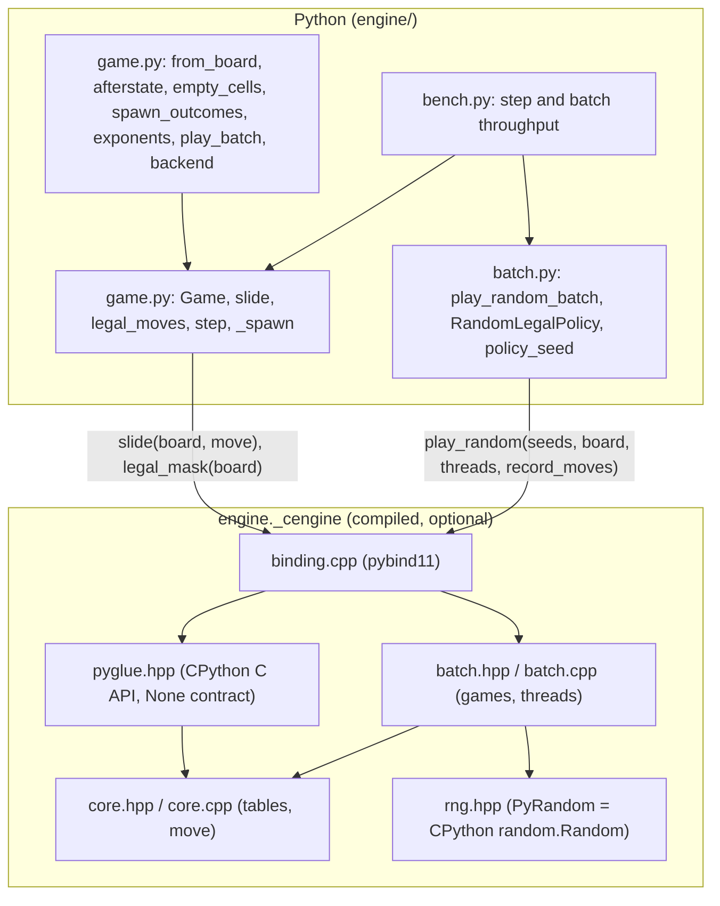
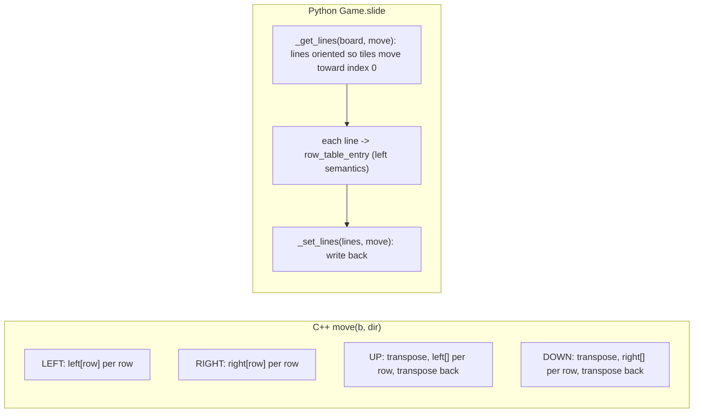
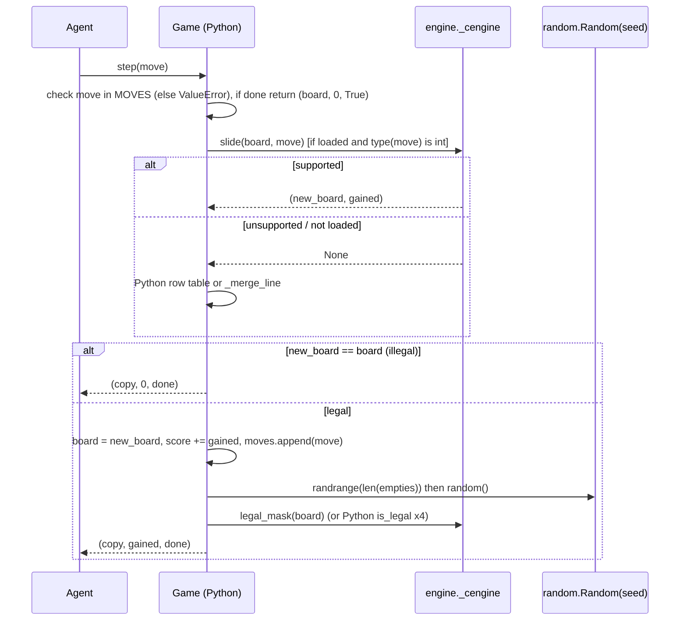
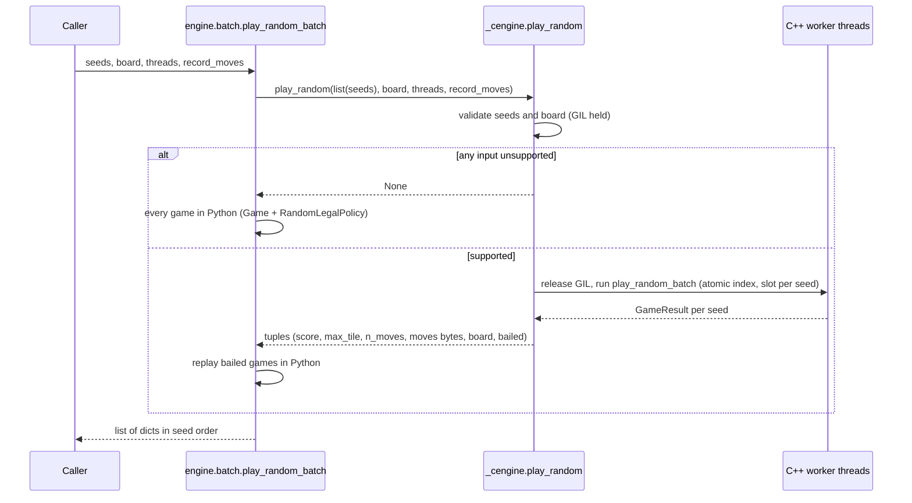

# P1 Engine — Architecture

**Snapshot:** commit `d8379a0` (`p1-engine-batch3c`). Everything here was checked against the source files
named in each section. Line numbers drift; search by function name.

## 1. Layers at a glance



The extension is optional. Without it (not built, fails to load, or `ENGINE_PURE_PYTHON` set to anything but
`""`/`"0"`), `game._cengine` is `None` and everything runs in Python with identical results.

## 2. Public board representation

* `Game.board` is a 4x4 `list[list[int]]` of **tile values**: `0` empty, otherwise 2, 4, 8, ..., 65,536, ...
  (`engine/game.py`). This is the shared interface in `AGENTS.md`; agents and tests read it directly.
* Row-major: `board[r][c]`, `r` = row from the top (0..3), `c` = column from the left (0..3).
* Moves: `UP=0, RIGHT=1, DOWN=2, LEFT=3` (`MOVES = (0, 1, 2, 3)`).
* Every board the API returns is a fresh list (copies), so callers cannot alias the game's internal board.

## 3. Internal 5-bit exponent representation

A cell is stored as its exponent: `0` = empty, `k` = tile `2**k` (2 -> 1, 65,536 -> 16, 131,072 -> 17).

* 5 bits hold exponents 0..31. 4 bits would stop at 15 (32,768), so 32,768 + 32,768 = 65,536 (exponent 16)
  would not fit. That is the reason for 5 bits.
* A row (or line) = 4 cells x 5 bits = a **20-bit key**. Cell `i` occupies bits `[5i, 5i+4]`; cell 0 is in the
  lowest bits. Python: `pack_row(exps)` / `unpack_row(key)` in `game.py`. C++: `pack` / `cell_of` in `core.cpp`.
* C++ board: `struct Board { uint32_t row[4]; }` (`core.hpp`), each row a 20-bit key, `row[r]` cell `c` = the
  exponent at `board[r][c]`. Four `uint32_t` instead of one `__uint128_t` because MSVC has no 128-bit integer.

**Range limits.**

| Engine | Exponents accepted | What happens beyond |
|---|---|---|
| Python row table | 0..31 (tiles up to 2^31) | Cells that are not 0 or a power of two in 2..2^31 (e.g. 3, 1, -2) use the original `_merge_line` on tile values, so behaviour matches the skeleton engine |
| C++ core | 0..18 (tiles up to 262,144 = `kMaxSupportedExp`) | `pyglue` refuses the board (`None`) and Python handles it. Inside `core.cpp`, rows containing an exponent > 18 are stored unchanged with score 0 so nothing overflows; callers must check `is_supported()` |

Why 18: a move on a board with exponents ≤ 18 creates at most exponent 19, and one row's score is at most
2 x 2^19 = 2^20, far inside 32 bits. A real 4x4 game cannot exceed 131,072 (exponent 17); 262,144 only appears
on artificial boards built with `Game.from_board`.

## 4. Row encoding and lookup tables

### C++ (`core.cpp`) — fully precomputed

```
tables():                                     // built once (C++11 static local init is thread-safe)
  left[key]  = slide_left(key)                for all 2^20 keys  -> {row after a left move, score}
  right[key] = { reverse(left[reverse(key)].row), left[reverse(key)].score }
```

* `slide_left`: drop empties, then walk left to right merging equal neighbours **once** (a freshly merged tile
  is skipped: `i += 2`), score `2^(e+1)` per merge, pad with zeros.
* Size: 2 tables x 2^20 entries x 8 bytes (`uint32_t row, score`) = 16 MiB per process.
* When: `PYBIND11_MODULE` calls `p1::init_tables()`, so the tables are built when `engine._cengine` is imported.
  `engine/_core/README.md` describes this as "a small fraction of a second"; we did not time it separately.

### Python (`game.py`) — lazily filled

* `_ROW_TABLE: dict` maps key -> `(slid key, score)`; `row_table_entry(key)` computes with `_slide_row_exps` on
  first use and caches.
* Design decision: filling 2^20 Python entries at import would cost seconds, and real games touch a small
  fraction of rows. The cache grows for the life of the process.
* Only a **left** table exists in Python; orientation is handled by the line helpers below.

## 5. The four directions



* **C++:** `transpose` turns column `c` into row `c` (cell `r` = old row `r`). Sliding a transposed row "left"
  moves tiles toward row 0 (up); using the right table moves them toward row 3 (down).
* **Python:** `_get_lines` returns, per move, the 4 lines read in the direction tiles travel toward:
  LEFT = rows as-is, RIGHT = rows reversed, UP = columns top-to-bottom, DOWN = columns bottom-to-top.
  Each line is slid "left" via the table, then `_set_lines` writes it back in the same orientation.
* Both are checked against the original `_merge_line` oracle: Python for all 17^4 rows
  (`test_row_table_matches_reference_for_every_row_up_to_65536`), C++ for all 19^4 rows in every direction as
  rows and columns (`test_every_row_up_to_exponent_18_matches_python`, plus `selftest.cpp`).
* Merge rules (both engines): each tile merges at most once per move (`[2,2,2,2] -> [4,4,0,0]`), merges happen
  toward the move direction first (`[2,2,2,0]` left -> `[4,2,0,0]`), no chain merges (`[4,2,2,0]` left -> `[4,4,0,0]`).

## 6. Python engine, dispatch and fallback (`engine/game.py`)

At import:

```python
_cengine = None
if os.environ.get("ENGINE_PURE_PYTHON", "") in ("", "0"):
    try:
        from . import _cengine
    except ImportError:
        _cengine = None
```

`Game.slide(board, move)`:
1. If `_cengine` is loaded **and** `move.__class__ is int` (so `bool`, numpy ints and floats skip C++), call
   `_cengine.slide(board, move)`. A non-`None` result is returned directly.
2. Else: `_get_lines` (raises `ValueError` for a move outside 0..3), then `_slide_lines_table`; if any cell is not
   encodable it returns `None` and the original `_merge_line` path runs.

`Game.legal_moves()`: `_cengine.legal_mask(self.board)` if available and not `None`, else
`[m for m in MOVES if Game.is_legal(self.board, m)]`.

**The `None` contract** (`engine/_core/pyglue.hpp`): the extension never raises for unsupported input; it returns
`None`. Supported means: the board is an exact `list` or `tuple` of 4 exact `list`/`tuple`s of 4 **exact** Python
`int`s (`PyLong_CheckExact`: rejects `bool`, numpy ints, floats, subclasses), each 0 or a power of two from 2 to
2^18; the move is an exact `int` 0..3. Results are fresh nested lists of Python ints.

Switches: `ENGINE_PURE_PYTHON=1` forces Python; `backend()` returns `"cpp"` or `"python"`; `ENGINE_REQUIRE_CPP=1`
is read only by the test `test_extension_is_built_when_required` (fails if the extension is missing).

## 7. C++ core and pybind11 integration

`engine/_core/binding.cpp` defines `PYBIND11_MODULE(_cengine, m)`:

| Python name | C++ | GIL |
|---|---|---|
| `slide(board, move)` | `p1glue::slide` -> `p1::move` | held (short call) |
| `legal_mask(board)` | `p1glue::legal_mask` -> `p1::legal_mask` | held |
| `MAX_SUPPORTED_EXP` | `p1::kMaxSupportedExp` (18) | — |
| `play_random(seeds, board=None, threads=0, record_moves=True)` | parse with GIL, then `p1::play_random_batch` with the GIL **released**, then build results with GIL | released while playing |
| `POLICY_SEED_MASK` | `p1::kPolicySeedMask` | — |
| `PyRandom(seed)` with `getrandbits`, `random`, `randbelow`, `getstate` | `p1::PyRandom` (test helper) | held |

`pyglue.hpp` uses only the plain CPython C API, so the conversion logic does not depend on pybind11.

Build (`setup.py`): `Pybind11Extension("engine._cengine", sources=[binding.cpp, core.cpp, batch.cpp],
cxx_std=17, optional=True)`, `/EHsc` on Windows (core throws `std::invalid_argument`), `-pthread` elsewhere
(std::thread). If pybind11 is not installed, no extension is declared at all. Either way a failed build is only a
warning, so check `backend()` after building.

## 8. CPython-compatible RNG (`engine/_core/rng.hpp`)

Purpose: C++ games must use exactly the numbers `random.Random(seed)` would produce, so they can be compared
game for game with the Python engine.

| CPython | C++ `PyRandom` | Detail that must match |
|---|---|---|
| `random.Random(seed)` (int seed) | `PyRandom::from_seed(abs_seed)` | `abs(seed)` split into 32-bit little-endian words, at least one word (seed 0 -> `[0]`), then MT19937 `init_by_array` (after `init_genrand(19650218)`). So `Random(-5)` == `Random(5)`. C++ handles `abs(seed) < 2^64` (1 or 2 words) |
| `genrand_uint32` | `next32()` | Standard MT19937 twist and tempering; starts "exhausted" (index 624) so the first draw twists |
| `getrandbits(k)`, k ≤ 32 | `getrandbits(k)` | Top k bits of one 32-bit output: `next32() >> (32 - k)` |
| `random()` | `random()` | `a = next32() >> 5`, `b = next32() >> 6`, `(a * 2^26 + b) / 2^53` |
| `randrange(n)` | `randbelow(n)` | `k = n.bit_length()`, draw `getrandbits(k)` until `< n` (rejection; the number of outputs consumed varies; `n = 1` still draws) |

Verified by `tests/test_engine_rng.py` against the real `random.Random`: the full 624-word state for edge seeds
(including negative, 2^32, 2^64, 2^100+12345), every `getrandbits` width 1..32, `random()` bit for bit,
`randbelow` values and output consumption, and the state after long runs.

**Assumption:** CPython's `randrange` -> `_randbelow_with_getrandbits` and `random()` implementations stay as
above in future Python versions. They are the same in 3.11 (CI) and 3.13 (dev container, per the README). If a
future CPython changed them, `tests/test_engine_rng.py` and the parity test would fail, which is the intended
alarm.

## 9. Spawning and determinism

Python (`Game._spawn`, unchanged since the skeleton):

```python
empties = self.empty_cells()                       # row-major
r, c = empties[self.rng.randrange(len(empties))]   # 1st draw: cell
self.board[r][c] = 2 if self.rng.random() < 0.9 else 4   # 2nd draw: value
```

C++ (`batch.cpp`, `spawn`): the same, with empties as flat indices `r*4+c` in row-major order,
`rng.randbelow(n)` then `rng.random() < 0.9`.

Rules that make a game reproducible from `(seed, moves)`:
* One `random.Random(seed)` per game, created in `reset`. `Game(seed)` spawns twice at the start;
  `Game(seed, board)` / `from_board` spawn nothing.
* After each **legal** move: slide, add score, record the move, spawn once. An illegal move (board unchanged)
  is a no-op: reward 0, no spawn, **no RNG use**, not recorded.
* `done` = no legal move left.
* The extension never touches the `Game` RNG, so backends cannot diverge.

## 10. Random batch self-play and multithreading (Batch 3c)

**The policy** ("uniform random legal move"): a second generator per game,
`policy = random.Random(abs(seed) ^ 0x2545F4914F6CDD1D)`; legal moves listed ascending (up, right, down, left);
move = `legal[policy.randrange(len(legal))]`. Separate from the spawn RNG so move choice never shifts spawns.
Defined twice, identically: C++ `play_random_game` and Python `RandomLegalPolicy` (`engine/batch.py`).

**One C++ game** (`play_random_game`):

```
rng = PyRandom(abs_seed); policy = PyRandom(abs_seed ^ mask)
board = start board, or empty + spawn + spawn
loop:
  next[m] = move(board, m) for m in 0..3; legal = {m : next[m].board != board}
  if legal empty: stop
  m = legal[policy.randbelow(len(legal))]; board = next[m].board; score += gained; record m
  spawn(board, rng)
  if started from a supplied board and !is_supported(board): bailed = true; stop
```

Only games started from a supplied board are watched for leaving the supported range (a fresh 4x4 game cannot
pass exponent 17).

**Thread pool** (`play_random_batch` in `batch.cpp`): `workers = threads > 0 ? threads :
std::thread::hardware_concurrency()`, clamped to `[1, n]`. An `std::atomic<size_t>` hands out game indexes; each
worker writes `results[i]` for its own `i`; the calling thread works too. Tables are built before workers start.
Shared state is only the atomic counter and the read-only tables, so **results never depend on the thread count**
(`test_results_do_not_depend_on_thread_count`).

**Python wrapper** (`engine/batch.py`, `play_random_batch`):
1. `seeds = list(seeds)`; shape-check `board` (`ValueError`).
2. If the extension has `play_random`, call it. It returns `None` for the **whole batch** if any seed is not an
   exact `int` with `abs(seed) < 2^64`, or the start board is not supported. Then every game is played in Python.
3. Per game, if C++ set `bailed`, that game is replayed from scratch by Python (`_play_python`).
4. Results: `{seed, score, max_tile, n_moves, moves, board}` per seed, in input order.

Consequence (performance cliff, not a correctness issue): a single unsupported seed in a large list sends the
entire batch to the slow Python path.

## 11. GIL handling

* `slide` / `legal_mask`: hold the GIL (microsecond calls; releasing it would cost more than it saves).
* `play_random`: reads seeds and the board **with** the GIL (Python objects), copies them into C++ vectors, then
  `py::gil_scoped_release` around `p1::play_random_batch` (pure C++, no Python objects touched), then re-acquires
  to build the result list. Other Python threads run meanwhile;
  `test_concurrent_python_threads_get_correct_results` runs four Python threads calling it at once.
* `play_batch` uses processes (`multiprocessing`), not threads, because Python agents hold the GIL.

## 12. How it fits together

### A move through `Game.step()`



Every move costs several Python calls, list copies and Python RNG calls, which is why `Game.step()` stays around
0.07–0.19M moves/s even with C++ (see `P1_TESTING_AND_BENCHMARKS.md`).

### A random batch



### `play_batch` (any Python agent)

`play_batch(agent_fn, seeds, processes=N, deterministic=True)`: one job per seed; `processes <= 1` runs in-process,
else a `multiprocessing` pool (`start_method` selects fork/spawn/forkserver; Windows and macOS default to spawn).
Each game is a normal `Game(seed)` driven by `agent_fn(game)`; an illegal move raises `ValueError`. With
`deterministic=True` each game gets `copy.deepcopy(agent_fn)` and, if `agent_fn` is a bound method of an object with
`reset`, `reset(seed)` is called first; the pool uses `chunksize=1`. Each spawned worker imports the engine, so it
builds its own 16 MiB C++ tables when the extension is present.

## 13. Known limitations of the design

* `Game.step()` is Python-bound (spawn, RNG, copies); C++ only accelerates `slide`/`legal_moves`.
* Only the random policy runs at C++ speed; real agents need their own C++/numba loops (as the P3/P5/P7 briefs say).
* `play_batch` always starts from `Game(seed)`; it has no `board` parameter (late-game starts: use `Game.from_board`
  directly, or `play_random_batch(board=...)` for the random policy).
* `play_random_batch` needs exact `int` seeds: numpy integer seeds and float seeds raise `TypeError` (numpy ints are
  rejected by `random.Random`; floats fail in `policy_seed`'s XOR). `engine/README.md` currently says such seeds are
  "played by Python"; that statement is inaccurate.
* `Game.step` accepts any value equal to 0..3 (inherited from the skeleton): `step(True)` and `step(1.0)` are
  accepted and recorded as `True` / `1.0` in `moves`. Pass plain ints.
