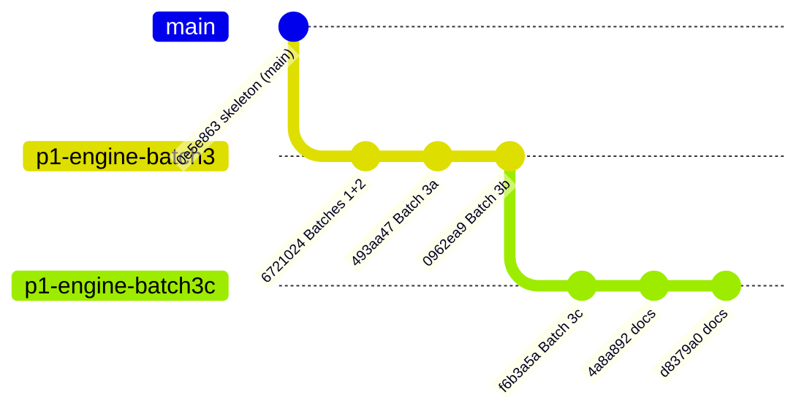

# P1 — Git and Handover Status

**Snapshot:** 2026-11-16, P1 head commit `d8379a0` on `p1-engine-batch3c`. PR and CI details below were read from
the public GitHub API (`api.github.com/repos/Dhrithi-sh/solver-65536`) on that date; they will change. Re-check
before acting.

## 1. Headline

* **Nothing from P1 is on `main` yet.** `main` is still the project skeleton `0e5e863`.
* All P1 work sits in two **open, unmerged, unreviewed** pull requests that are **stacked**:
  PR #10 (`p1-engine-batch3` -> `main`) and PR #11 (`p1-engine-batch3c` -> `p1-engine-batch3`).
* CI passed (all 4 jobs) on the head of each PR: `0962ea9` (PR #10) and `d8379a0` (PR #11).
* Correction to a common shorthand: PR #10 is often described as "Batches 3a and 3b", but it contains **three
  commits covering Batches 1, 2, 3a and 3b** (see section 3).

## 2. Branch structure



| Branch | Tip | Remote? | Notes |
|---|---|---|---|
| `main` | `0e5e863` | `origin/main` | Skeleton only. Protected according to `CONTRIBUTING.md` (branch-protection settings not verified; they need admin access) |
| `p1-engine-batch3` | `0962ea9` | `origin/p1-engine-batch3` | Head of PR #10 |
| `p1-engine-batch3c` | `d8379a0` | `origin/p1-engine-batch3c` (in sync) | Head of PR #11; the latest P1 work |
| `p1-engine-batch1` | `0e5e863` | local only | Same commit as `main`; no unique work |
| `p1-engine-batch2` | `6721024` | local only | Contained in `p1-engine-batch3`; no unique work |
| `origin/p5-ntuple` | `7361728` | remote | P5's PR #9 (not P1). Touches `agents/ntuple/`, `requirements.txt`, two new test files; **no file in common with P1's changes**, so no conflict with P1 is expected |

## 3. Commit history (P1)

| Commit | Date | Message | Content | In PR |
|---|---|---|---|---|
| `0e5e863` | 2026-11-12 | Project skeleton: engine, agent API, benchmark harness, CI | Not P1 (baseline) | on `main` |
| `6721024` | 2026-11-16 | Complete P1 engine batches 1 and 2 | `engine/game.py`, `engine/README.md`, `tests/test_engine_p1.py`, `tests/test_engine_helpers.py` | #10 |
| `493aa47` | 2026-11-16 | Add C++ engine core and standalone tests | `engine/_core/core.*`, `selftest.cpp`, `gen_golden.py`, `_core/README.md` | #10 |
| `0962ea9` | 2026-11-16 | Integrate optional C++ engine with Python | `pyglue.hpp`, `binding.cpp`, `setup.py`, `pyproject.toml`, `ci.yml`, `engine/bench.py`, `game.py`, `tests/test_engine_cengine.py`, `tests/test_build_config.py`, READMEs | #10 |
| `f6b3a5a` | 2026-11-16 | Add fast C++ random self-play with CPython-exact RNG (P1 batch 3c) | `rng.hpp`, `batch.hpp/.cpp`, `binding.cpp`, `engine/batch.py`, `bench.py`, `game.py`, `setup.py`, tests, READMEs | #11 |
| `4a8a892` | 2026-11-16 | docs: update P1 engine verification results | `engine/README.md`, `engine/_core/README.md` | #11 |
| `d8379a0` | 2026-11-16 | docs: finalize P1 engine documentation | `engine/README.md`, `engine/_core/README.md`, `engine/game.py` (docstring only) | #11 |

## 4. Pull requests

### PR #10 — "P1: C++ Game Engine and Python Integration"

| Field | Value (as reported by GitHub) |
|---|---|
| Head -> base | `p1-engine-batch3` (`0962ea9`) -> `main` |
| Commits / files | 3 commits (`6721024`, `493aa47`, `0962ea9`); 17 files, +2373 / −16 |
| State | open, not merged, not draft |
| Reviews | none |
| Requested reviewer | `Dhrithi-sh` (the repository owner) |
| Labels / linked issue | none / none |
| Mergeable | `true`; `mergeable_state` = `unstable` |
| CI on `0962ea9` | workflow run succeeded, all 4 jobs passed |

* `unstable` normally means GitHub sees a commit status or check that is not successful. The CI workflow run on
  `0962ea9` succeeded, so the cause is **unknown**; check the PR's "Checks" tab before merging.
* **The PR description is out of date**: it says "Full test suite: 104 tests passed" and "macOS/Linux CI: pending
  verification". At `0962ea9` CI has since passed on Ubuntu, Windows and macOS. Its benchmark figures (90,277 C++ step,
  4,426 Python step moves/s) were not re-measured. Update the description before review.

### PR #11 — "P1: Fast C++ Random Self-Play and Batch Engine"

| Field | Value (as reported by GitHub) |
|---|---|
| Head -> base | `p1-engine-batch3c` (`d8379a0`) -> **`p1-engine-batch3`** (not `main`) |
| Commits / files | 3 commits (`f6b3a5a`, `4a8a892`, `d8379a0`); 13 files, +1124 / −49 |
| State | open, not merged, not draft |
| Reviews / requested reviewers | none / none |
| Labels / linked issue | none / none |
| Mergeable | `true`; `mergeable_state` = `clean` |
| CI on `d8379a0` | workflow run succeeded: `test (ubuntu-latest)`, `test (windows-latest)`, `test (macos-latest)`, `test (pure-Python fallback)` |

Its description says "macOS verification remains dependent on CI"; macOS has since passed CI (still never tested on a
local Mac).

### CI history (workflow `CI`)

| Commit | Branch | Event | Result |
|---|---|---|---|
| `d8379a0` | `p1-engine-batch3c` | pull_request | success (4/4 jobs) |
| `4a8a892` | `p1-engine-batch3c` | pull_request | success (4/4 jobs) |
| `0962ea9` | `p1-engine-batch3` | pull_request | success (4/4 jobs) |
| `0e5e863` | `main` | push | success |

The workflow runs only on `push` to `main` and on `pull_request` events, so a branch without a PR gets no CI.

## 5. Review requirements (from `CONTRIBUTING.md` and `AGENTS.md`)

* One approval from the review buddy: **P1 ↔ P2**. If the buddy is away for more than two days, any teammate can
  review. (Who P2 is: not recorded in the repo; the team table says "TBD".)
* CI must be green; `pytest` must pass locally before pushing; new code needs tests.
* Add the role label (`P1-engine`) and link the issue (`Closes #N`). Neither PR has these yet.
* Changes to shared interfaces (public `engine/` API, `agents/base.py`) need a heads-up to the whole group first.
  P1's PRs add APIs but change no existing signature.

## 6. Correct merge order

1. **PR #10 first** (into `main`).
2. **Then PR #11**, after it has been retargeted to `main` (or after `p1-engine-batch3` has been merged and GitHub
   retargets it).

Never merge PR #11 into `p1-engine-batch3` and then forget PR #10; and never merge PR #11 into `main` before #10.
Merging #11 into `main` first would also bring in #10's commits without #10's review.

## 7. Continuing after PR #10 merges / retargeting PR #11 to `main`

What to do depends on **how** PR #10 is merged (the repository's allowed merge methods are not known to us):

**A. "Create a merge commit"** (keeps the original SHAs; simplest for a stacked PR)
1. Merge PR #10.
2. Retarget PR #11: GitHub web UI -> PR #11 -> "Edit" next to the title -> change base to `main`. With the GitHub
   CLI: `gh pr edit 11 --base main` (`gh` was not installed on the handover machine). If `p1-engine-batch3` is deleted
   after the merge, GitHub normally retargets dependent PRs to `main` automatically (documented GitHub behaviour, not
   tried on this repo).
3. PR #11's diff against `main` should now show only `f6b3a5a`, `4a8a892`, `d8379a0`.

**B. "Squash and merge" or "Rebase and merge"** (rewrites #10's commits, so PR #11 would show them again and may conflict)
1. Merge PR #10.
2. Rebase only the 3c commits onto the new `main`, using the old #10 tip as the cut point:
   ```bash
   git fetch origin
   git switch p1-engine-batch3c
   git rebase --onto origin/main 0962ea9 p1-engine-batch3c
   ENGINE_REQUIRE_CPP=1 python -m pytest && ENGINE_PURE_PYTHON=1 python -m pytest
   git push --force-with-lease origin p1-engine-batch3c      # rewrites a pushed branch: get agreement first
   ```
3. Retarget PR #11 to `main` as in A.2.

**CI after retargeting:** the workflow listens to `pull_request` with GitHub's default activity types (opened,
synchronize, reopened). Changing the base branch is an "edited" event, so it is not expected to start a new run.
Make sure a run exists **against `main`** before merging #11: push a commit (case B does), close and reopen the PR, or
re-run the workflow from the Actions tab. (Expected behaviour; not tried on this repo.)

## 8. Checklist before merging each PR

- [ ] PR description updated (test counts, CI status, benchmarks with machine/mode/threads; the 1M target is met by
      `play_random_batch()` only).
- [ ] `P1-engine` label added, issue linked.
- [ ] Review approval from P2 (or a teammate per the two-day rule).
- [ ] All 4 CI jobs green on the PR's **current** head and base (`main` for both before merging into `main`).
- [ ] PR #10's `mergeable_state` `unstable` explained/resolved.
- [ ] Locally, on a fresh build of exactly the head commit:
      `python setup.py build_ext --inplace --force`, `backend()` prints `cpp`,
      `ENGINE_REQUIRE_CPP=1 python -m pytest` (expected: 104 tests at PR #10's head, count verified by
      collection, all reported passing in its description and CI; 130 passed with PR #11, verified at `d8379a0`),
      `ENGINE_PURE_PYTHON=1 python -m pytest`.
- [ ] `python -m eval.run --agent random --games 10 --seed0 0` then `python -m eval.replay results/random.jsonl --index 0`.
- [ ] No build artefacts in the diff (`*.pyd`, `*.so`, `build/`, `golden.txt`, `selftest*`, `*.obj`) and no `results/`.
- [ ] `tests/test_engine.py` and `agents/base.py` unchanged versus `main`.
- [ ] The team has been told which new APIs exist (point them to `engine/README.md`, "Public API reference (final)").

## 9. What remains unmerged or unverified

**Unmerged:** all P1 work (Batches 1, 2, 3a, 3b in PR #10; 3c and docs in PR #11).

**Unverified or unknown:**
* macOS on a local machine (CI only).
* The cause of PR #10's `mergeable_state: unstable`.
* Branch-protection settings on `main` and the allowed merge methods.
* Who P2 (the review buddy) is.
* CI logs (only job/step conclusions were read): CI benchmark numbers and runner compiler versions.
* `play_batch` throughput.
* Whether retargeting PR #11 triggers CI (expected not to).
* Python 3.12 has not been tested by us (CI uses 3.11; the dev container used 3.13 and 3.11 per `engine/README.md`).

**Open documentation issues in the repo** (not fixed, because the handover was documentation-only):
* `engine/README.md` says numpy-int and float seeds passed to `play_random_batch` are played by Python; both actually
  raise `TypeError` in the Python fallback.
* PR #10 and PR #11 descriptions are stale (see section 4).
* The top-level `README.md` does not link to the build instructions in `engine/README.md`.

## 10. About this handover folder

All five handover documents in `handover/P1/` have been committed and pushed on branch `p1-handover-docs`
(commit `e614e76`, based on `main` at `0e5e863`). That branch is separate from the P1 implementation branches
(`p1-engine-batch3`, `p1-engine-batch3c`) and does not touch PR #10 or PR #11. `AGENTS.md` lists top-level docs as
"everyone, via a reviewed PR", so the documents reach `main` only through a reviewed pull request from
`p1-handover-docs`; they are not on `main` yet.
