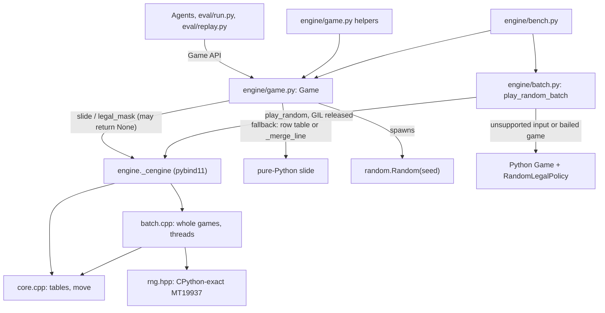

# P1 (Game Engine) — Master Handover

**Snapshot:** commit `d8379a0` on branch `p1-engine-batch3c`, 2026-11-16.
**Audience:** the developer taking over P1 and the AI coding assistant they use. Neither has seen the
earlier conversations; this package is meant to be enough on its own.

Companion documents in this folder:

| File | Read it for |
|---|---|
| `P1_MASTER_HANDOVER.md` (this file) | What P1 is, what was built, status, rules, what to do next |
| `P1_ARCHITECTURE.md` | How the engine works inside (representation, tables, C++, RNG, threads, GIL) |
| `P1_API_REFERENCE.md` | Every public function/class with exact signatures, edge cases and tests |
| `P1_TESTING_AND_BENCHMARKS.md` | Building, testing, benchmarking; which results are verified where |
| `P1_GIT_AND_HANDOVER_STATUS.md` | Branches, commits, PRs #10 and #11, merge order, pre-merge checklist |

How to read the labels used throughout:

* **Verified** = we ran it and saw the result (command and machine are given), or GitHub reported it.
* **Design decision** = a deliberate choice, with the reason.
* **Assumption** = believed true but not checked.
* **Outstanding** = work not done yet.
* **Unknown** = information not available to us.

---

## 1. Project overview and objective

An 8-person university project: AI agents that play 2048 on a 4x4 board and push toward the 65,536 tile.
Search-based, learned and hybrid agents are compared on identical seeded games. The project claims two
novelties: (1) a fair head-to-head of every approach on the same seeds; (2) a late-game benchmark that starts
from saved 32,768 boards and measures how often each agent reaches 65,536.

* Repository: `https://github.com/Dhrithi-sh/solver-65536` (Python 3.11).
* Project rules for coding agents: `AGENTS.md` (repo root). Human process: `CONTRIBUTING.md`. Overview: `README.md`.
* The original task brief is a PDF named `65536 Solver — Task Briefs.pdf`. It is **not in the repository**;
  the P1 requirements are copied into section 2 below. The brief says: where the repo differs from the brief,
  follow the repo.

Roles (from `README.md`): P1 engine (`engine/`), P2 heuristics, P3 expectimax, P4 baselines, P5 n-tuple
network, P6 deep RL, P7 hybrid, P8 evaluation/UI/report. **P1's review buddy is P2.** The team table in
`README.md` still lists every name as "TBD", so who P2 is cannot be read from the repo.

## 2. P1 responsibilities and requirements

P1 goal (brief): *replace the reference engine with a fast, correct engine that every other agent and
training loop runs on. Folder: `engine/`. Everyone is blocked on your API, so freeze it in week 1.*

| # | Brief task | Status | Where |
|---|---|---|---|
| 1 | Keep the public API identical; existing tests still pass | **Done, verified** | `engine/game.py`; `tests/test_engine.py` is byte-identical to the skeleton commit `0e5e863` |
| 2 | Store log2 exponents, 5 bits per cell (four 20-bit rows, e.g. `__uint128_t` or 4x `uint32`) or justify another scheme | **Done, verified** | 4x `uint32_t` rows in `engine/_core/core.hpp`; 20-bit row keys in `engine/game.py`. Public `Game.board` stays tile values (shared interface) |
| 3 | Precompute row tables (left move + score); derive right/up/down by reversal and transposes | **Done, verified** (C++ fully precomputed; Python fills lazily, documented trade-off) | `engine/_core/core.cpp`, `engine/game.py` |
| 4 | C++ with pybind11 in `engine/_core`; pure-Python fallback if not built | **Done, verified** | `engine/_core/*`, `setup.py`, `engine/game.py` |
| 5 | Helpers: `Game.from_board`, `afterstate`, `empty_cells`, `spawn_outcomes`, `exponents`, `play_batch` | **Done, verified** (the "fast" in "fast parallel `play_batch`" is unmeasured, see section 10) | `engine/game.py` |
| 6 | `engine/bench.py` reporting moves/sec for random play | **Done, verified** | `engine/bench.py` |
| 7 | Tests: every direction, `[2,2,2,2] -> [4,4,0,0]`, 32,768+32,768 -> 65,536, C++ = Python on 10,000 seeded games, seeded games repeat | **Done, verified** | `tests/test_engine*.py` |
| 8 | C++ build in CI; build steps for Windows, macOS, Linux in the README | **Done, verified** | `.github/workflows/ci.yml`, `engine/README.md` |
| — | Done when: all tests pass, C++ and Python agree exactly, C++ engine ≥ 1M moves/sec on a laptop, 65,536 works | **Met, with one qualification:** the 1M target is met **only by `play_random_batch()`**, not by `Game.step()` or `play_batch()` | see section 10 |
| — | Report back: moves/sec before vs after, representation and why, final API list | Done in `engine/README.md` ("Speed", "Representation (and why)", "Public API reference (final)") | |
| — | "Then help P7 with C++ performance" | **Outstanding** (`agents/hybrid/` holds only a README) | |

Other roles' briefs depend on P1: P3 and P7 use `spawn_outcomes`/`empty_cells` (expectimax chance nodes);
P5 uses `afterstate` and `exponents` (TD learning on afterstates); P6 wraps the engine in a Gymnasium env
(one-hot `(18, 4, 4)` exponents); P8's late-game benchmark needs `Game.from_board` and replay from a
`start_board`. P3, P5 and P7 are told to put their hot loops in C++ or numba because Python is too slow.

## 3. Implementation timeline

| Batch | Commit | What it introduced |
|---|---|---|
| Skeleton (not P1) | `0e5e863` | Reference engine `engine/game.py` (simple, correct, slow), `agents/base.py`, `eval/run.py`, `eval/replay.py`, `tests/test_engine.py`, `tests/test_agents.py`, CI |
| Batch 1 | `6721024` (together with Batch 2) | 5-bit exponent row table inside `Game.slide`, 65,536 support, fallback to the original merge for odd boards; `tests/test_engine_p1.py` |
| Batch 2 | `6721024` | Helpers `Game.from_board`, `afterstate`, `empty_cells`, `spawn_outcomes`, `exponents`, `play_batch`; `tests/test_engine_helpers.py` |
| Batch 3a | `493aa47` | C++ core `engine/_core/core.hpp/.cpp` (precomputed tables, four directions), standalone `selftest.cpp`, `gen_golden.py`, `engine/_core/README.md` |
| Batch 3b | `0962ea9` | `pyglue.hpp` (CPython C-API conversion, "None = unsupported" contract), `binding.cpp` (pybind11 module `engine._cengine`), `setup.py`, build config in `pyproject.toml`, `backend()` and dispatch in `game.py`, `engine/bench.py`, CI on 3 OSes + pure-Python job, `tests/test_engine_cengine.py`, `tests/test_build_config.py` |
| Batch 3c | `f6b3a5a` | `rng.hpp` (CPython-exact `random.Random` in C++), `batch.hpp/.cpp` (whole random games, thread pool), `play_random`/`PyRandom` in the binding, `engine/batch.py` (`play_random_batch`), `play_batch(deterministic=..., start_method=...)`, `engine.bench` batch mode, `tests/test_engine_batch.py`, `tests/test_engine_rng.py` |
| Docs | `4a8a892`, `d8379a0` | Windows verification results; final API reference, before/after speed table, verification status, `_core` README updates. Docs and one docstring only |

## 4. What each batch did, in more detail

**Batch 1 — Python internals.** `Game.board` stays a 4x4 list of tile values. Inside `Game.slide`, each line is
converted to 5-bit exponents and packed into a 20-bit key (`pack_row`), which indexes `_ROW_TABLE`, a dict
filled on first use (`row_table_entry`). If any cell is not 0 or a power of two from 2 to 2^31, `slide` uses
the original `_merge_line` instead. Spawning, RNG and `step` were left untouched, so games are identical to
the skeleton engine move for move (`test_engine_matches_original_rules_move_for_move`).

**Batch 2 — helpers** (all plain Python, below the `Game` class in `engine/game.py`). Each is in
`P1_API_REFERENCE.md`.

**Batch 3a — C++ core.** A board is four `uint32_t` rows of 4x5-bit exponents. Two tables of 2^20 entries
(left, right) map a row to `(row after move, score)`. Up/down transpose, use left/right, transpose back.
Supported exponents ≤ 18; larger rows are stored unchanged with score 0 and callers must check
`is_supported()`. No Python, no RNG in this layer. Checked by `selftest.cpp`.

**Batch 3b — binding and integration.** `engine/game.py` imports `engine._cengine` if available (and
`ENGINE_PURE_PYTHON` is not set). `Game.slide` and `Game.legal_moves` ask it first; it returns `None` for
anything it does not support and the Python code then runs unchanged. Spawning and the RNG stay in Python, so
`Game` games are identical with or without the extension. The build is optional (`optional=True`).

**Batch 3c — fast random self-play.** To run whole games in C++ and still match Python exactly, the C++ side
re-implements CPython's Mersenne Twister, seeding, `getrandbits`, `random()` and `randrange`. `batch.cpp` plays
the "uniform random legal move" policy with a second, separate RNG for move choice. `play_random_batch` runs
many games across `std::thread`s with the GIL released. `play_batch` gained a `deterministic=True` mode so
stateful Python agents give the same results for any process count.

## 5. Architecture overview

Details, sequence diagrams and the reasoning are in `P1_ARCHITECTURE.md`.

## 6. Repository file map (P1-relevant)

| Path | Role |
|---|---|
| `engine/__init__.py` | Re-exports `Game, Board, MOVES, MOVE_NAMES, UP, RIGHT, DOWN, LEFT` (unchanged since the skeleton) |
| `engine/game.py` | The engine: `Game`, helpers, row table, dispatch to C++, `backend()` |
| `engine/batch.py` | `play_random_batch`, `RandomLegalPolicy`, `policy_seed`, `POLICY_SEED_MASK` |
| `engine/bench.py` | `python -m engine.bench` throughput benchmark (step and batch modes) |
| `engine/README.md` | P1 documentation (representation, helpers, batch play, speed, build, verification, API) |
| `engine/_core/core.hpp/.cpp` | C++ board, tables, `move`, `is_legal`, `legal_mask`, `is_supported` |
| `engine/_core/pyglue.hpp` | Python <-> C++ board/move conversion with the `None` contract (plain CPython C API) |
| `engine/_core/binding.cpp` | pybind11 module `engine._cengine` |
| `engine/_core/rng.hpp` | `PyRandom`: CPython-compatible `random.Random` |
| `engine/_core/batch.hpp/.cpp` | Whole random-policy games and the thread pool |
| `engine/_core/selftest.cpp`, `gen_golden.py` | Standalone C++ checks and Python-generated golden vectors |
| `engine/_core/README.md` | C++ layer documentation and standalone build commands |
| `setup.py` | Declares the optional extension (sources, `/EHsc` on MSVC, `-pthread` elsewhere) |
| `pyproject.toml` | Metadata; build-system requires setuptools + pybind11; excludes `engine._core` from packages; pytest config |
| `.github/workflows/ci.yml` | CI: build + tests on ubuntu/windows/macos, pure-Python job |
| `tests/test_engine.py` | Skeleton engine tests (must never change without the group) |
| `tests/test_engine_p1.py` | Batch 1 |
| `tests/test_engine_helpers.py` | Batch 2 |
| `tests/test_engine_cengine.py` | Batch 3b (extension, fallback, differential tests) |
| `tests/test_build_config.py` | Batch 3b/3c build configuration |
| `tests/test_engine_batch.py` | Batch 3c (10,000-game parity, batch play, `play_batch` determinism) |
| `tests/test_engine_rng.py` | Batch 3c (C++ RNG vs `random.Random`) |
| `tests/test_agents.py`, `eval/`, `agents/` | Not P1's, but they run on the engine and their tests must keep passing |

Build artefacts that must never be committed: `engine/_cengine*.pyd` / `*.so`, `build/`, `golden.txt`,
`selftest(.exe)`, `*.obj`. (`.gitignore` covers `*.so` and `build/`; `.pyd` is ignored only because
`*.py[cod]` happens to match it.)

## 7. Shared API contract and compatibility requirements

From `AGENTS.md` and `CONTRIBUTING.md` (summarised; full reference in `P1_API_REFERENCE.md`):

* Board: `list[list[int]]`, 4x4, `0` = empty, otherwise the tile value.
* Moves: `0=up 1=right 2=down 3=left`.
* Spawns: a 2 with p=0.9 or a 4 with p=0.1, in a uniformly chosen empty cell, from `random.Random(seed)`.
  **RNG call order: cell index first (`randrange(len(empties))`, empties in row-major order), then value
  (`random() < 0.9`).**
* `Game(seed, board=None)`, `reset(seed, board=None)`, `step(move) -> (board, reward, done)` (illegal move =
  no-op with reward 0), `legal_moves()`, `max_tile()`, attributes `board, score, moves, done, seed`, static pure
  `Game.slide(board, move) -> (new_board, gained)`.
* `agents.base.Agent` (`name`, `reset(seed)`, `choose_move(game) -> int`, must be legal and must not mutate the
  game) and `ValueFunction.evaluate(board) -> float`.
* Benchmark `eval/run.py`; results `results/<agent>.jsonl` with `agent, seed, score, max_tile, n_moves, moves
  (digit string), ms_per_move`.
* Rule from `CONTRIBUTING.md`: adding new optional helpers is fine; renaming or changing signatures is not
  without telling the group (team chat + an issue).

Compatibility promises P1 currently keeps (all tested):
a seed plus a move list reproduces a game exactly, with or without the extension; the C++ batch reproduces the
pure-Python engine exactly; 65,536 (and 131,072) work in both engines.

## 8. Key implementation decisions (and why)

| Decision | Why |
|---|---|
| Public board stays tile values; exponents only internally | Every agent and test reads `game.board`; the brief says follow the repo where it differs |
| 5 bits per cell | 4 bits stop at 2^15 = 32,768, so 32,768+32,768 = 65,536 would not fit |
| Four `uint32_t` rows instead of `__uint128_t` | MSVC (Windows) has no 128-bit integer type |
| C++ tables cover exponents ≤ 18 | A move then creates at most exponent 19 and a row score stays far inside 32 bits; real 4x4 play cannot exceed 131,072 (exponent 17). Larger boards fall back to Python |
| Python row table filled lazily | Filling 2^20 rows in Python costs seconds at import; games touch a small fraction |
| Extension optional, `None` = "not handled" | Nobody needs a compiler to use the engine; unsupported input (numpy ints, odd boards, huge tiles) silently gets the exact Python answer |
| Spawns/RNG stay in Python inside `Game` | Guarantees identical games with or without C++; keeps the `Game` contract unchanged. Cost: `Game.step()` stays Python-speed |
| Bit-exact CPython RNG in C++ (3c) | Spawns must come from `random.Random(seed)`; reproducing it exactly lets C++ games be checked against Python game for game |
| Separate policy RNG `random.Random(abs(seed) ^ 0x2545F4914F6CDD1D)` | Choosing moves never shifts the spawn sequence (same seed = same spawns for every agent) |
| Only the random policy runs in C++ | A Python `agent_fn` cannot run inside C++; `play_batch` remains the tool for real agents |
| `play_batch(deterministic=True)` deep-copies the agent per game and calls `reset(seed)` | Without it, stateful agents give results that depend on process count and pool chunking |
| Results per seed written to their own slot | Batch results never depend on thread count |

## 9. Git state (summary; full detail in `P1_GIT_AND_HANDOVER_STATUS.md`)

* `main` = `0e5e863` (skeleton only). **No P1 work is on `main` yet.**
* **PR #10** `p1-engine-batch3` (`0962ea9`) -> `main`: 3 commits = Batches 1, 2, 3a, 3b. Open, not merged, no
  reviews yet.
* **PR #11** `p1-engine-batch3c` (`d8379a0`) -> `p1-engine-batch3`: 3 commits = Batch 3c + two docs commits.
  Open, not merged, no reviews yet. It is stacked on PR #10.
* CI (verified via the GitHub API): all four jobs passed on `0962ea9` and on `d8379a0`.
* Merge order: PR #10 first, then PR #11 retargeted to `main`.

## 10. Completion status and outstanding work

**Complete and verified:** every engine requirement in section 2, full test suite (130 tests) passing with C++
and (102 passed, 28 C++-only skipped) without it, 10,000-game parity, CI green on Ubuntu, Windows and macOS.

**The 1M moves/sec target — read carefully.** It is met **only by `engine.batch.play_random_batch()`** (whole
random-policy games in C++): 2,274,174 moves/s on 1 thread and 18,870,104 on 14 threads on the Windows laptop.
It is **not** met by `Game.step()` (68k–103k moves/s with C++, ~5.8k pure Python on the same laptop) and **not**
by `play_batch()`, which runs Python agents through `Game.step()`. Do not report it as "the engine does 1M
moves/sec" without that qualification.

**macOS:** passed CI (`macos-latest`) but has **not** been built or tested on a local Mac by us.

**Outstanding (not done):**

1. Get PR #10 and PR #11 reviewed and merged (P1 is not integrated into `main`; other roles cannot build on
   it from `main`).
2. PR #10's description is stale (says "104 tests" and "macOS/Linux CI: pending verification"); update it.
   Neither PR has the `P1-engine` label or a linked issue, both asked for by `CONTRIBUTING.md`.
3. `selftest.cpp` is not run in CI (only by hand).
4. `play_batch` throughput has never been measured.
5. `engine/README.md` says non-int seeds (numpy ints, floats) passed to `play_random_batch` are "played by
   Python". In fact both raise `TypeError` in the Python fallback (numpy ints are rejected by
   `random.Random`; floats fail in `policy_seed`). Exact ints of any size, including negative and ≥ 2^64, work.
   Documentation fix needed, or a code change agreed with the team.
6. Help P7 with C++ performance (brief).
7. The top-level `README.md` does not point to the build instructions in `engine/README.md`.
8. `engine/__init__.py` does not re-export the helpers, `backend`, or `play_random_batch` (import them from
   `engine.game` / `engine.batch`). Changing this is an API change: ask the group first.

## 11. Instructions for the next developer and their AI assistant

1. Read `AGENTS.md`, then this folder, then `engine/README.md`. Treat source code as the final authority.
2. Set up Python **3.11** in `.venv` (see `P1_TESTING_AND_BENCHMARKS.md`). The machine used so far also had
   Python 3.13 on `PATH`; a cp311 extension does not load there, so always use the venv interpreter.
3. Build: `python setup.py build_ext --inplace`, then check `python -c "from engine import game; print(game.backend())"`
   prints `cpp`. A failed build only warns.
4. Before any change, run the full suite both ways:
   `ENGINE_REQUIRE_CPP=1 python -m pytest` and `ENGINE_PURE_PYTHON=1 python -m pytest`. Both must pass.
5. After editing any `.cpp`/`.hpp` file: `python setup.py build_ext --inplace --force`, rerun both suites.
6. Work only in `engine/` (P1's folder) unless a task says otherwise; use branches named `p1-<topic>`; open PRs
   into `main`; never push to `main`; do not commit build artefacts, `results/`, `weights/`, `logs/`.
7. Report numbers only from `python -m eval.run` on the shared seeds (project rule). Engine throughput comes from
   `python -m engine.bench`; always say which mode, how many threads, and which machine.
8. AI assistants: do not invent APIs; check signatures in source (`inspect.signature` works). Ask the human before
   pushing, force-pushing, merging, retargeting PRs or changing shared interfaces.

## 12. Do not change without checking with the team

* Any public signature or behaviour in `P1_API_REFERENCE.md` marked "original" (shared interface), and the
  P1 additions other roles may already use.
* The spawn rule and the **RNG call order** (cell, then value), and the use of `random.Random(seed)`. Changing
  either breaks every saved result and replay.
* `Game.board` being a 4x4 list of tile values.
* `tests/test_engine.py` (the skeleton's tests) and `agents/base.py`.
* `POLICY_SEED_MASK` (`0x2545F4914F6CDD1D`) and the random policy definition: they define the 10,000-game parity
  games and the benchmark's games. It must equal `p1::kPolicySeedMask` in `batch.hpp` (a test checks this).
* `rng.hpp`: any change must keep `tests/test_engine_rng.py` and the parity test passing.
* `kMaxSupportedExp = 18` and the `None` contract in `pyglue.hpp`/`binding.cpp`: Python relies on `None` to fall
  back.
* `ENGINE_PURE_PYTHON` / `ENGINE_REQUIRE_CPP` semantics: CI depends on them.
* CI workflow and `requirements.txt` (shared; heavy dependencies go in per-folder files).
